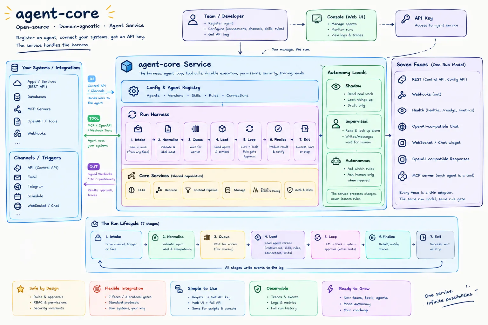
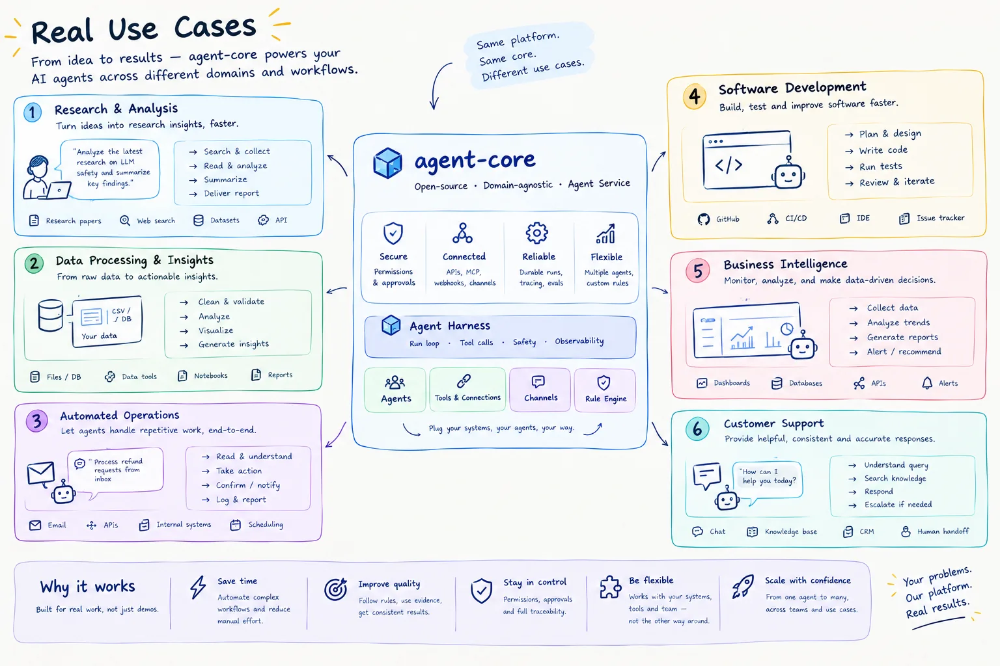

# agent-core

**An open-source, domain-agnostic agent service.** Register an agent, connect your systems, get an API key. agent-core runs the harness: the agent loop, tool calls, rules, human approval, durable runs and a verifiable event log.

You manage the agent. The service runs it.

> **Status: in development.** No released version yet; not for production. The pictures below show the target design, not only what is built. [ROADMAP.md](ROADMAP.md) is the one place that tracks progress: a ticked task is built.



## Why agent-core

Building an agent is easy. Running one safely against real systems is not. Each team ends up rebuilding the same harness: retries, approvals, permissions, audit logs, evals. agent-core is that harness, as one service that many agents and teams share.

- **Safe by default.** An unknown tool counts as a write that reaches outside. Writes wait for a human until a rule allows them. A rule gate checks every tool call before it runs, and code never loosens a rule by itself.
- **Your systems, standard protocols.** No team code runs inside the service. Everything connects through three gates:

  | Gate | Direction | Protocols |
  |---|---|---|
  | **In** | Your system → agent | Control API (`POST /v1/runs`), later channels and triggers |
  | **Tool** | Agent → your system | MCP, signed webhook tools, later OpenAPI |
  | **Out** | Agent → your system | Signed webhooks, later SSE and OpenTelemetry |

- **Verifiable.** Every run is an append-only, hash-chained event log. Run state is recomputed from events, so you can check what happened and why.
- **Domain-agnostic.** The same core runs a support agent, a research agent or an operations agent. A new agent is configuration, not a code change.

## Use cases



The first reference agent is `retail-support`: it looks up orders and refunds them, and a human approves large refunds. The quickstart below runs it against a mock shop.

## Quickstart

Prerequisites: Node.js 24, pnpm 10 and Docker.

```bash
pnpm install
cp .env.example .env     # set LLM_API_KEY, LLM_MODEL_DEFAULT and AGENT_CORE_MASTER_KEY (openssl rand -base64 32); any OpenAI-compatible endpoint works
pnpm db:up               # Postgres on localhost:5433
pnpm mock:shop           # terminal 2: mock shop MCP server on http://127.0.0.1:7400/mcp
pnpm dev                 # terminal 1: agent-core on http://localhost:7300
```

Then connect the shop, create an agent and start a run. The key is `AGENT_CORE_ADMIN_KEY` from `.env`.

```bash
AUTH="Authorization: Bearer change-me"
JSON="Content-Type: application/json"

# 1. Connect the mock shop, then confirm the safety the service proposes for each tool.
curl -s -X POST localhost:7300/v1/connections -H "$AUTH" -H "$JSON" -d '{"id":"shop","url":"http://127.0.0.1:7400/mcp"}'
for t in orders.get inventory.check payments.refund orders.change_size; do
  curl -s -X PATCH localhost:7300/v1/connections/shop/tools/$t -H "$AUTH" -H "$JSON" -d '{"confirm":"proposed"}'
done

# 2. Create an agent. Refunds up to 1,000,000 are allowed; larger ones wait for a human.
curl -s -X POST localhost:7300/v1/agents -H "$AUTH" -H "$JSON" -d '{
  "id": "retail-support",
  "instructions": "You are a support assistant for a shop. Use the tools to look up orders and refund them.",
  "connections": ["shop"],
  "autonomy": "supervised",
  "allow": [{ "tool": "payments.refund", "when": { "amount": { "lte": 1000000 } } }]
}'

# 3. Start a run and wait up to 30 seconds for it to settle.
curl -s -X POST "localhost:7300/v1/runs?wait=30" -H "$AUTH" -H "$JSON" -d '{
  "agent": "retail-support",
  "input": { "text": "My shirt is defective, please refund order 1042" },
  "principal": { "id": "cus_2291", "roles": ["customer"] }
}'
```

Order 1042 costs 1,200,000, so the run stops with `"status":"waiting_human"`. Approve it, then read the result and the event log:

```bash
RUN=run_...   # the "id" from the response
curl -s -X POST localhost:7300/v1/runs/$RUN/input -H "$AUTH" -H "$JSON" -d '{"action":"approve"}'
curl -s localhost:7300/v1/runs/$RUN -H "$AUTH"
curl -s localhost:7300/v1/runs/$RUN/events -H "$AUTH"
```

### More of the API

- **Tool safety.** `GET /v1/connections/{id}/tools` shows what the model sees and each tool's safety. Hints only make a tool stricter; loosening needs `PATCH /v1/connections/{id}/tools/{tool}`. A tool whose definition changed since review is hidden from the model until you confirm it again.
- **Webhook tools.** Register a connection with `"kind":"webhook"`. Each call is a signed `POST` with an idempotency key. Contract: [packages/tools/README.md](packages/tools/README.md).
- **Run input.** Everything a human sends to a run goes to `POST /v1/runs/{id}/input` with an `action`: `approve`, `reject`, `outcome_happened`, `outcome_not_happened`, `continue`, `cancel`, or `message` with a `text` that steers the run at its next LLM call. `cancel` also stops a running run before its next step.
- **Unknown outcomes.** When a write's result is lost, the run waits with `"waiting_reason":"unknown_outcome"`. Answer with `outcome_happened`, `outcome_not_happened` or `cancel`.
- **Connection protection.** A connection takes an optional `limits` block: `calls_per_minute` (default 60) and `concurrency` (default 4), shared by all runs and workers of the tenant. A circuit breaker opens after 5 failed calls in a row, stays open 30 s, then lets one trial call through. A call that must wait is deferred with a `retryAt` (`tool.deferred`); the run neither fails nor waits for a human. After an hour of waiting the call gets the tool error `Connection unavailable.`
- **Follow-ups.** An agent whose `allow` names `agent_core.schedule_followup` can pause a run with `after_seconds` (60 s to 30 days) and a `note`. The run is `sleeping` until then, survives a restart, and gets the note back when it wakes. At most 10 follow-ups per run.
- **Limits.** An agent's `limits` block bounds LLM calls, tokens, cost per run and per tenant per day, run time, time waiting for a human and tool output size. A breach pauses the run with `"waiting_reason":"limit"`; answer with `continue` (one more allowance) or `cancel`. A wait past `wait_human_s` fails the run.
- **Models.** `pnpm models:check` probes each model alias and proposes a profile; `GET /v1/models` shows the profiles.

## Contributing

[AGENTS.md](AGENTS.md) holds the commands, the rules and where to look; [CONTRIBUTING.md](CONTRIBUTING.md) holds the pull request flow.

## License

[MIT](LICENSE)
